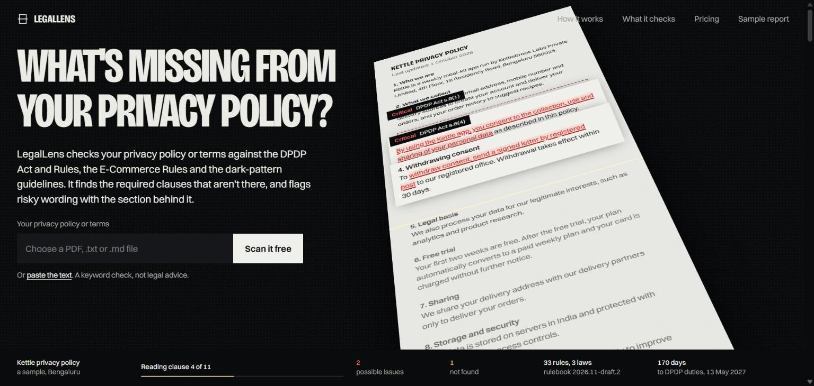
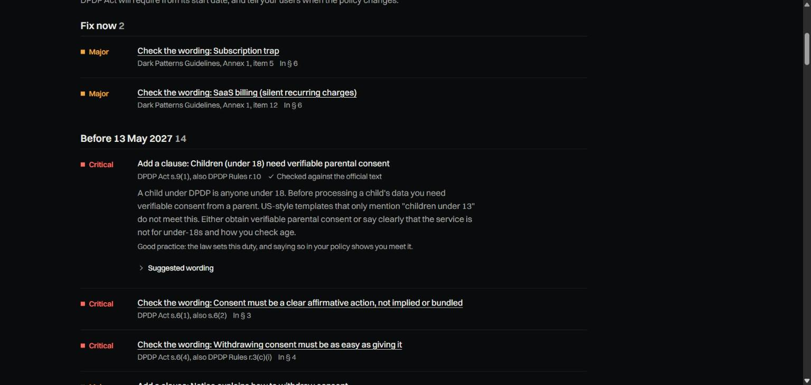

# LegalLens

A compliance auditor for Indian startups: it checks a privacy policy or terms of service against the
DPDP Act and Rules, the E-Commerce Rules and the dark-pattern guidelines, and tells the founder what
to change.



> LegalLens is a keyword check of the wording against a rulebook. It is compliance help, not legal
> advice.

## What it does

- **Scores the policy.** It checks the policy against 33 rules from three Indian laws and gives a
  0–100 score. Each rule cites its section and is weighted by severity.
- **Finds the missing clauses.** It lists the clauses the law expects and that no part of the policy
  covers, such as verifiable parental consent for under-18s or how to complain to the Data
  Protection Board.
- **Flags risky wording.** It marks the exact words in the clause that resemble something the law
  restricts, such as consent that is hard to withdraw or a free trial that turns paid without
  notice.
- **Gives an action plan.** It groups the fixes by when they are due for the founder's situation
  (writing a first policy, fixing a live one, or a quick check-up). Each clause to add comes with
  what the law asks and suggested wording.
- **Writes the draft fixes.** It downloads the policy as Markdown, with a note after each flagged
  clause and suggested wording for each missing one. It also prints a report, or exports the full
  result as JSON.
- **Flags unfair terms (API).** A trained classifier marks sentences that resemble eight categories
  of unfair Terms of Service, such as unilateral change, limitation of liability or arbitration. See
  [Trained model](#trained-model).



## Laws in scope

| Law | Rules checked | Applies to |
|---|---|---|
| Digital Personal Data Protection Act, 2023 and DPDP Rules, 2025 | 22 | Every business. Most duties apply from 13 May 2027 |
| Consumer Protection (E-Commerce) Rules, 2020 | 6 | Online stores and marketplaces |
| Guidelines for Prevention and Regulation of Dark Patterns, 2023 (CCPA) | 5, plus 8 to check by hand in the app's screens | Every business |

The rulebook lives in [`legallens/rulebook/`](legallens/rulebook/) as YAML (version
`2026.11-draft.2`). Each rule records the statute quote it rests on and whether that quote has been
checked against the official Gazette text.

## Review options and pricing

| Review option | Plan (planned) |
|---|---|
| Quick check-up: the score, the five things to do first and the risks to watch | Free for the first 3 check-ups, then Monitoring, about ₹1,999 a month |
| Fixing a live policy: fixes grouped into now, before the DPDP date and at the next update | Full audit report, about ₹4,999 once |
| Writing our first policy: what to get right before and soon after launch | Full audit report, about ₹4,999 once |

LegalLens is in early access, so every review is free for now and nothing counts or limits use. The
prices are indicative. Payments will run in test mode only until the business is set up.

## Quick start

You need Python 3.10 or newer. LegalLens was developed on 3.14.

```bash
python -m venv .venv
# Windows (PowerShell)
.venv\Scripts\Activate.ps1
# macOS / Linux
source .venv/bin/activate

pip install -r requirements.txt
uvicorn webapp.main:app
```

Open http://127.0.0.1:8000 and choose **Sample report** to see a full audit of a sample policy
without uploading anything.

## Using it

### Web app

1. **Home:** scan the sample policy, read how it works and what it checks, and see the pricing.
2. **Audit a policy:** upload a PDF with selectable text, a `.txt` or `.md` file, or paste the text.
   Answer two questions:
   - what the business does: app or website, online store, or marketplace;
   - what you need from this review.
3. **Results:**
   - the score and what it rests on;
   - the action plan;
   - the policy itself, with a note in the margin of each flagged clause. Severity filters, a fold
     toggle and `j` / `k` move between flags;
   - a checklist of the dark patterns that only show in an app's screens.

   **Print report**, **Download draft fixes** and **Export data (JSON)** keep a copy. The results
   page has light and dark themes; the homepage is dark.

### API

`POST /api/audit` takes a file or a `text` field, plus `business_type` (`app`, `ecommerce` or
`marketplace`) and `goal` (`prelaunch`, `live` or `quick`), and returns the whole audit as JSON:

```bash
curl -F "file=@privacy-policy.pdf" -F business_type=app -F goal=live http://127.0.0.1:8000/api/audit
```

Here is the response for `data/samples/sample_privacy_policy.txt`, trimmed to one finding and one
missing clause:

```json
{
  "score": { "value": 57, "earned": 87.0, "possible": 153, "estimated": true },
  "mode": "partial",
  "rulebook_version": "2026.11-draft.2",
  "findings": [
    {
      "id": "f3",
      "rule_id": "dpdp.consent.withdrawal_ease",
      "title": "Withdrawing consent must be as easy as giving it",
      "severity": "critical",
      "verdict": "unclear",
      "clause_index": 3,
      "evidence": { "start": 542, "end": 599, "text": "withdraw consent, send a signed letter by registered post" },
      "source": "keyword"
    }
  ],
  "missing": [
    { "rule_id": "dpdp.children.parental_consent", "title": "Children (under 18) need verifiable parental consent",
      "severity": "critical", "law_name": "DPDP Act", "section": "s.9(1)" }
  ],
  "guidance": { "goal": "live", "groups": [ { "label": "Fix now" }, { "label": "Before 13 May 2027" } ] },
  "unfair_terms": { "status": "ok", "sentences_checked": 31, "flags": [] }
}
```

- The full response also has `rules`, `groups`, `manual_checks`, `clauses`, `text` and `warnings`.
- `mode` is `partial` because the audit is a keyword check, so the score is an estimate.
- Errors return a `detail` message with status 400 (bad input), 411 (no `Content-Length` header),
  413 (too large) or 422 (no text could be extracted).

`POST /api/segment` returns the clauses only, each with the keyword risk tags from the research
baseline.

### CLI and Python

```bash
python -m legallens segment data/samples/sample_privacy_policy.txt --json
```

```python
from legallens import load_document, normalize_text, segment
from legallens.compliance.audit import audit

text = normalize_text(load_document("data/samples/sample_privacy_policy.txt"))
report = audit(text, segment(text), business_type="app", mode="keyword")
print(report.score["value"], [m["title"] for m in report.missing])
```

## How it works

1. **Ingest and clean** ([`legallens/preprocess.py`](legallens/preprocess.py)):
   - reads text-based PDFs with `pypdf`;
   - removes running headers, footers and page numbers;
   - rejoins hyphenated words.
2. **Segment** ([`legallens/segmentation.py`](legallens/segmentation.py)): splits the policy into
   clauses from its own numbering and headings, keeping exact character offsets.
3. **Check** ([`legallens/compliance/`](legallens/compliance/)). Each rule's hints are sentence-bounded
   patterns, run by the keyword checker:
   - a match on a required rule means the topic is covered;
   - a match on a prohibited rule is a possible issue to read, never a verdict;
   - a required rule that no clause covers is missing.

   An AI checker is built and tested with a fake client as a future paid feature. It stays off
   without an API key.
4. **Score and plan** (`report.py`, `guidance.py`):
   - Severity weights: critical 10, major 5, minor 2. A possible issue earns half.
   - The action plan follows the review goal. Its wording lives in
     [`legallens/rulebook/guidance.yaml`](legallens/rulebook/guidance.yaml).
5. **Present** ([`webapp/`](webapp/)): FastAPI and Jinja templates with plain CSS and JavaScript.

Keyword-mode evaluation on six real Indian privacy policies is in
[`docs/evaluation.md`](docs/evaluation.md):
- On held-out policies it flagged no false violations (precision 1.00).
- It caught 6 of 9 real violations (recall 0.67).
- It found missing clauses with precision 0.89 and recall 1.00.

It is a small sample, so treat these as early numbers.

## Trained model

A TF-IDF and logistic-regression classifier, trained on LexGLUE UNFAIR-ToS, flags sentences that
resemble eight categories of unfair terms:
- limitation of liability
- unilateral termination
- unilateral change
- content removal
- contract by using
- choice of law
- jurisdiction
- arbitration

It scores a held-out test macro-F1 of 0.7386.

- **Rebuilt from the research notebook:** [`scripts/build_unfair_model.py`](scripts/build_unfair_model.py)
  reproduces the notebook's recorded test results exactly.
- **No scikit-learn at runtime:** the model is exported as plain data files, and a standard-library
  engine runs it.
- **API only:** it runs on `POST /api/audit`, under `unfair_terms`. It never changes the compliance
  score, and the web pages don't show it yet.

Details, metrics and limits are in [`docs/unfair_terms_model.md`](docs/unfair_terms_model.md).

## Tech stack

| Layer | Technology |
|---|---|
| Language | Python 3.10+ (developed on 3.14) |
| Core engine | Python standard library for ingestion and segmentation; [PyYAML](https://pyyaml.org/) and [pydantic](https://docs.pydantic.dev/) for the rulebook |
| Trained model | Standard-library inference over exported weights; training uses scikit-learn 1.6.1 in a separate environment ([`scripts/requirements-model.txt`](scripts/requirements-model.txt)) |
| PDF extraction | [pypdf](https://pypi.org/project/pypdf/) (text-based PDFs only) |
| Web server and API | [FastAPI](https://fastapi.tiangolo.com/) served by [Uvicorn](https://www.uvicorn.org/), with `python-multipart` for uploads |
| Templates | [Jinja2](https://jinja.palletsprojects.com/) |
| Frontend | Plain HTML, CSS and JavaScript with self-hosted fonts; no framework or build step |
| Tests | [pytest](https://pytest.org/) with FastAPI's `TestClient` |

## Limitations

- **Keyword checks read words, not meaning.** "We never sell your data" still mentions selling data,
  and wording the patterns haven't seen is missed. Every flag is "possible", and the score is an
  estimate.
- **The rulebook is a draft.** The dark-pattern rules haven't been checked against the official text
  yet, and nothing here has been reviewed by a lawyer.
- **PDF input:** scanned PDFs have no text to read (there is no OCR), and two-column layouts haven't
  been tested.
- **The trained model's categories** come from an English consumer-terms benchmark, not Indian law.
  A clause with no flag is not shown to be fair.

The results page warns when the extracted text looks unreliable. That covers no text, missing
section numbers, very long clauses, and one heading carried by many clauses.

## Privacy

- **In memory only:** uploads are processed in memory and discarded once the response is sent.
  Nothing is written to disk.
- **Nothing leaves the machine:** keyword mode and the trained model run locally.
- **Logs:** they record sizes, counts and timings, never document content.
- **Limits:** 10 MB and 200 pages per upload. Oversized requests are rejected before the body is
  read.
- **Local by default:** `uvicorn` listens on `127.0.0.1`.

## Project layout

```
legallens/                core: preprocess.py, segmentation.py, risk.py (research baseline), CLI
legallens/compliance/     audit engine: rulebook, keyword and AI checkers, report, guidance, unfair-terms model
legallens/rulebook/       the rules as YAML, one file per law, plus guidance.yaml
webapp/                   FastAPI app: main.py, audit_view.py, landing_view.py, templates/, static/
scripts/                  eval_audit.py (evaluation), build_unfair_model.py (rebuilds the model)
tests/                    pytest suite and fixture policies
data/samples/             the sample privacy policy and terms of service
docs/                     evaluation, the model, the demo script, design direction, screenshots
DESIGN.md, PRODUCT.md     the design system and the product brief
LegalLens.pdf             the research paper
```

## Tests

```bash
python -m pytest
```

There are 301 tests. They cover:
- segmentation;
- the rulebook and the keyword checks against fixture policies with planted violations;
- the report and the action plan;
- the trained model's parity with scikit-learn;
- the web app and the API.

## Research background

LegalLens started as the research project in
[*NLP-Based Legal Clause Simplification and Risk Detection*](LegalLens.pdf). It had three
classifier arms:
- **Keyword baseline:** `legallens/risk.py`, still served by `/api/segment`.
- **Trained classifier:** now the unfair-terms model above.
- **LLM-prompted classification:** now the AI checker, built but switched off.

This version turns that work into a product for the entrepreneurship minor. The research
version's history is kept in this repository.

## Team

- **Authors:** Varsha Lokesh, Vinochan Rajesh, Punya Chandrashekar, Riya S. Mujumdar
- **Project guide:** Dr./Prof. Lokesh J. K
- **Institution:** School of Computer Science and Engineering, RV University, Bengaluru, India

### Citation

If you use LegalLens, please cite the project paper:

```bibtex
@misc{legallens2026,
  title        = {NLP-Based Legal Clause Simplification and Risk Detection},
  author       = {Lokesh, Varsha and Rajesh, Vinochan and Chandrashekar, Punya and Mujumdar, Riya S.},
  year         = {2026},
  institution  = {School of Computer Science and Engineering, RV University},
  note         = {LegalLens project}
}
```

## License

LegalLens is released under the [MIT License](LICENSE).

The bundled fonts have their own licences:
- Bricolage Grotesque: SIL Open Font License,
  [`webapp/static/fonts/OFL-BricolageGrotesque.txt`](webapp/static/fonts/OFL-BricolageGrotesque.txt)
- Switzer: ITF Free Font License,
  [`webapp/static/fonts/FFL-Switzer.txt`](webapp/static/fonts/FFL-Switzer.txt)
