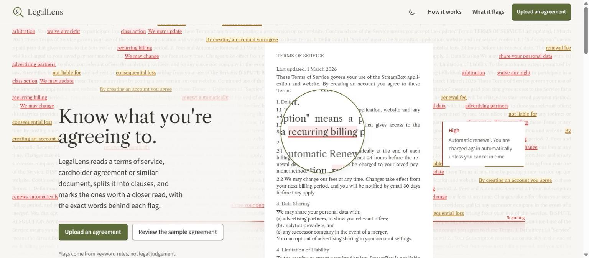
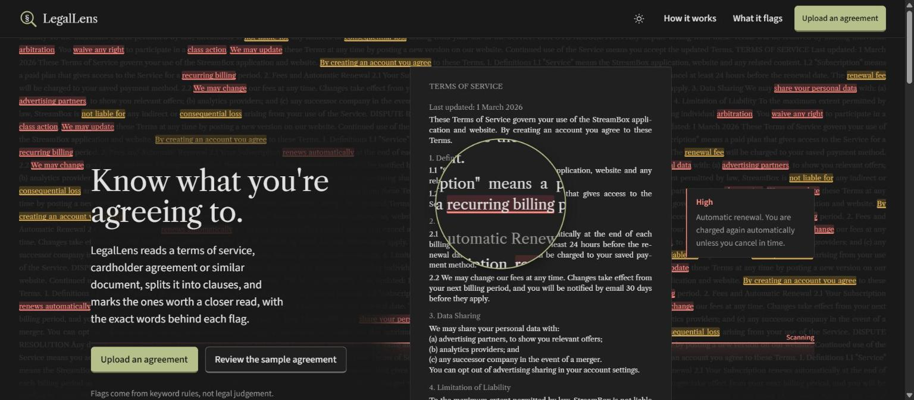

# LegalLens

Clause segmentation and risk flagging for legal and consumer agreements.



> LegalLens gives automated keyword flags, not legal advice.

## What it does

- **Splits an agreement into clauses.** It takes a PDF with selectable text, a `.txt` or `.md` file, or pasted text. Each clause keeps its number, heading and exact character offsets in the extracted text.
- **Flags each clause** against 11 risk categories in three tiers (high, medium, low) and shows the exact phrases that triggered each flag.
- **Presents the result as an annotated document.** The web app adds margin notes, flag-by-flag navigation and a printable summary. The same analysis is available as a JSON API, a CLI and a Python library.

## Project status

LegalLens implements part of the system described in our paper, [*NLP-Based Legal Clause Simplification and Risk Detection*](LegalLens.pdf).

| Part | Status |
|---|---|
| Ingestion and cleaning (PDF/text, running headers and footers, page numbers, hyphenation) | Done |
| Rule-based clause segmentation (paper §V-B) | Done |
| Keyword risk baseline (paper §V-C, arm 1) | Done |
| Web demo, JSON API, CLI | Done |
| Fine-tuned transformer classifier (arm 2) | Planned |
| LLM-prompted classification (arm 3) | Planned |
| Plain-language summaries and explanations | Planned |
| Side-by-side comparison of two agreements | Planned |
| Evaluation (classification metrics, readability, information preservation) | Planned |

## Quick start

You need Python 3.10 or newer. LegalLens was developed on 3.14.

```bash
python -m venv .venv
# Windows
.venv\Scripts\activate
# macOS / Linux
source .venv/bin/activate

pip install -r requirements.txt
uvicorn webapp.main:app
```

Open http://127.0.0.1:8000 and choose **Review the sample agreement** to see the results page without uploading anything.

## Using it

### Web app


- **Home:** read the sample agreement through the lens. Move it with the pointer or the arrow keys, or use **Next flag**. Behind the page, the contract's fine print drifts past a scan line, and risky phrases are marked as they cross it.
- **Results:** the agreement appears as one annotated document.
  - **"What you're agreeing to"** lists each flagged category, with links to its clauses.
  - **Margin notes** give each clause's tier, categories and the phrases that matched.
  - **Navigation:** press `j` / `k` (or **Previous** / **Next**) to step through flags; the current one is spotlighted. Use the tier filters, **Fold unflagged**, or the minimap on the left to jump.
  - **Print summary** lists every flagged clause; choose "Save as PDF" in the print dialog to keep a copy. **Export data (JSON)** downloads the full analysis.
- **Themes:** light and dark. The site follows your system setting until you use the toggle in the header, and then remembers your choice.



### API

`POST /api/segment` takes either a file or pasted text and returns JSON. You can upload a file:

```bash
curl -F "file=@contract.pdf" http://127.0.0.1:8000/api/segment
```

Or send text as the `text` field (`<` makes curl read the field's value from a file):

```bash
curl -F "text=<data/samples/sample_tos.txt" http://127.0.0.1:8000/api/segment
```

Here is the response for `data/samples/sample_tos.txt`, trimmed to one clause and one piece of evidence:

```json
{
  "source": "sample_tos.txt",
  "text": "…the full extracted text…",
  "clauses": [
    {
      "index": 3,
      "text": "Your Subscription renews automatically at the end of each billing period unless you cancel at least 24 hours before the renewal date. The renewal fee will be charged to your saved payment method.",
      "number": "2.1",
      "heading": "Fees and Automatic Renewal",
      "start": 407,
      "end": 606,
      "risk": {
        "tier": "high",
        "categories": ["auto_renewal", "fees"],
        "evidence": [
          { "category": "auto_renewal", "start": 18, "end": 38, "text": "renews automatically" }
        ]
      }
    }
  ],
  "warnings": []
}
```

- `start` / `end` on a clause are offsets into `text`.
- Evidence offsets are relative to the clause's own `text`.
- Errors return a `detail` message with status 400 (bad input), 411 (no `Content-Length` header) or 413 (too large).

### CLI

The CLI runs segmentation only:

```bash
python -m legallens segment data/samples/sample_tos.txt
python -m legallens segment contract.pdf --json
```

### Python

```python
from legallens import load_document, segment, assess

for clause in segment(load_document("data/samples/sample_tos.txt")):
    risk = assess(clause.text)
    print(clause.number or "-", risk.tier, risk.categories)
```

## How it works

The pipeline has four stages:

1. **Ingest and clean** ([`legallens/preprocess.py`](legallens/preprocess.py))
   - Reads text-based PDFs with `pypdf`.
   - Removes running headers and footers (lines repeated at the top or bottom of most pages) and page-number lines.
   - Rejoins words hyphenated across lines and normalises quotes and spacing.
   - Keeps line breaks and numbering, because segmentation depends on them.
2. **Segment** ([`legallens/segmentation.py`](legallens/segmentation.py))
   - Uses document structure only. Numbered lines (`2.1`, `IV.`, `Section 4`, `§ 5`) start clauses. Headings, numbered or not, label the clauses that follow. Run-in labels like `Default:` start clauses. Sub-items such as `(a)` and bullets stay with their parent clause.
   - Line lengths are measured per document, so a wrapped line isn't mistaken for a heading.
   - A blank line after an unfinished sentence is treated as a page break, not a paragraph end.
3. **Flag** ([`legallens/risk.py`](legallens/risk.py))
   - Each category is a set of phrase patterns kept within one sentence.
   - A clause gets every category it matches, and the tier of the most serious one. Every match is kept as evidence.
4. **Present** ([`webapp/`](webapp/))
   - FastAPI and Jinja templates with plain CSS and JavaScript.
   - Evidence is located again in the document text, so phrases can be marked in place.

### Risk categories

| Tier | Category | What it means |
|---|---|---|
| High | Arbitration and waived rights | Disputes go to private arbitration, or you give up a jury trial or class action. |
| High | One-sided changes | The company can change the terms, prices or service on its own. |
| High | Automatic renewal | You are charged again automatically unless you cancel in time. |
| High | Data sharing | Your personal information can be shared with, or sold to, other companies. |
| Medium | Limited liability | The company limits what it owes you if something goes wrong. |
| Medium | Indemnification | You may have to cover the company's legal costs or losses. |
| Medium | Fees and interest | Charges, penalties or interest rates. |
| Medium | Suspension and termination | Accounts, access or the agreement can be suspended, closed or cancelled. |
| Medium | Governing law and venue | Which laws apply and where disputes must be heard. |
| Low | Agreement by use | Using the service counts as accepting the terms. |
| Low | Calls and messages | Consent to calls, texts or recording. |

A tier shows which topics a clause touches and how closely it is worth reading. It does not say whether a clause is unfair or enforceable. "No flags" means no watched phrase was found, not that a clause is safe.

## Limitations

These are known limits of the baselines, kept for error analysis:

- **Segmentation:**
  - A sentence-case heading directly followed by text ("Payment terms⏎You…") stays part of the clause text.
  - A paragraph whose last line reaches the page margin can merge with the next one.
  - Numbered lists inside a clause ("1) … 2) …") get split into separate clauses.
- **Headings:** short standalone lines such as a document title or "Last updated: …" are read as headings, and label every clause until the next heading.
- **PDF input:**
  - Scanned PDFs have no text to extract, and there is no OCR yet.
  - Two-column layouts haven't been tested.
  - Some PDF fonts drop section numbers.
- **Keyword flags:** they miss terms worded in ways the patterns don't anticipate, and they flag harmless mentions; "we never sell your data" still mentions selling data.

The web app shows a warning for each document where these are likely: no text extracted, missing section numbers, very long clauses, or one heading carried by many clauses.

## Privacy

- **In memory only:** uploads are processed in memory and discarded once the response is sent. Nothing is written to disk.
- **Logs:** they record sizes and counts, never document content.
- **Limits:** 10 MB and 200 pages per upload. Oversized requests are rejected before the body is read.
- **Local by default:** `uvicorn` listens on `127.0.0.1` by default. Exposing the server more widely is a separate decision, because uploads may be real agreements.

## Project layout

```
legallens/          core library: preprocess.py, segmentation.py, risk.py, CLI (__main__.py)
webapp/             FastAPI app: main.py, templates/, static/ (CSS, JS, self-hosted fonts)
tests/              pytest suite; pdf_builder.py generates test PDFs at runtime
data/samples/       sample_tos.txt, the bundled sample agreement
docs/screenshots/   images used in this README
DESIGN.md           the web app's design system: colour, type, motion, components
.ux-profile.md      project rules for the UI/UX design skills
LegalLens.pdf       the project paper
```

## Tests

```bash
python -m pytest
```

There are 72 tests, covering segmentation, risk tagging and the web app. The test PDFs are generated at runtime by [`tests/pdf_builder.py`](tests/pdf_builder.py), so no binary fixtures are committed.

## Design

The web app's direction is "the fine print, under a lens".
- **Home:** a reading lens over real fine print.
- **Results:** an annotated document rather than a dashboard.
- **Look:** colours follow a Notion-style paper palette with a muted olive accent.

Tokens, components, motion rules and accessibility targets (WCAG 2.1 AA) are documented in [`DESIGN.md`](DESIGN.md) and [`.ux-profile.md`](.ux-profile.md).

## Team

- **Authors:** Varsha Lokesh, Vinochan Rajesh, Punya Chandrashekar, Riya S. Mujumdar
- **Project guide:** Dr./Prof. Lokesh J. K
- **Institution:** School of Computer Science and Engineering, RV University, Bengaluru, India

### Citation

If you use LegalLens, please cite the project paper:

```bibtex
@misc{legallens2026,
  title        = {NLP-Based Legal Clause Simplification and Risk Detection},
  author       = {Lokesh, Varsha and Rajesh, Vinochan and Chandrashekar, Punya and Mujumdar, Riya S.},
  year         = {2026},
  institution  = {School of Computer Science and Engineering, RV University},
  note         = {LegalLens project}
}
```

## License

LegalLens is released under the [MIT License](LICENSE).

The bundled fonts, Libre Caslon Text and Source Sans 3, are under the SIL Open Font License. See [`webapp/static/fonts/OFL-LibreCaslonText.txt`](webapp/static/fonts/OFL-LibreCaslonText.txt) and [`webapp/static/fonts/OFL-SourceSans3.txt`](webapp/static/fonts/OFL-SourceSans3.txt).
